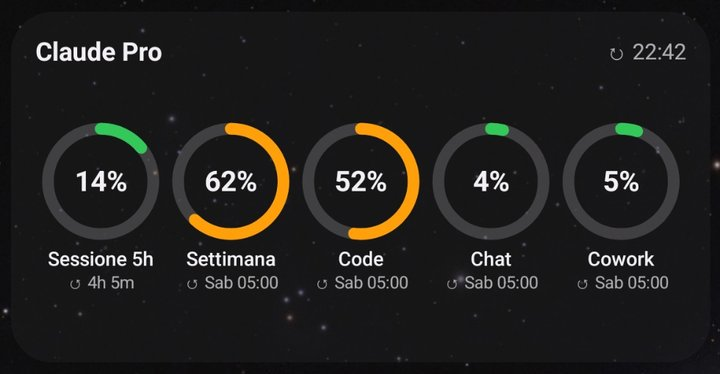
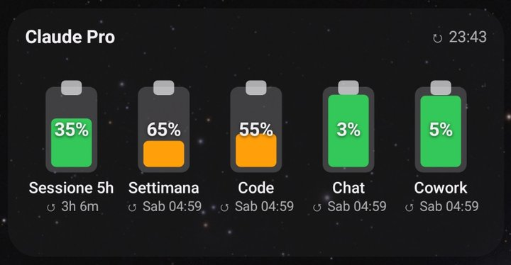
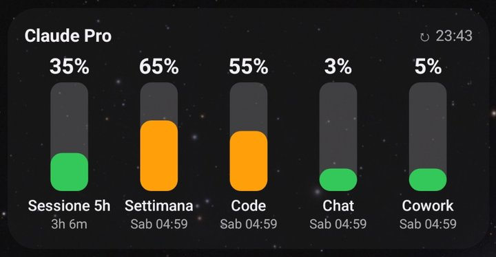
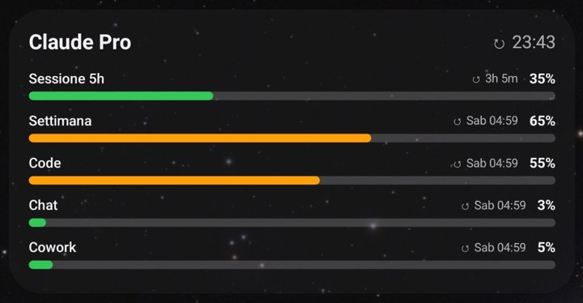
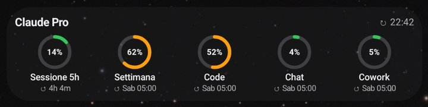
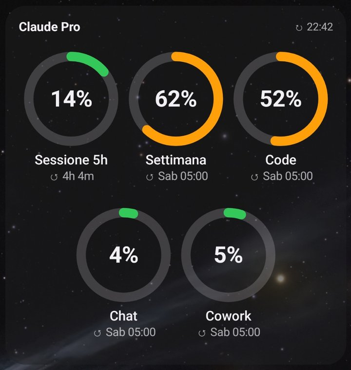

# Limits for Claude

[](https://github.com/Tattanu/limits-for-claude/actions/workflows/build.yml)
[](LICENSE)


**An Android home-screen widget that shows how much of your Claude usage limits you have used** —
5-hour session, weekly limit, model-specific limits, extra usage, and a per-product split
(Claude Code, chat, Cowork…) — drawn as rings, batteries, columns or bars, like a battery widget.

Works with any Claude account and plan (Free, Pro, Max, Team): it shows whatever limits your plan has.

🇮🇹 [Leggi in italiano](README.it.md)

### ▶ [Try the widget live in your browser](https://tattanu.github.io/limits-for-claude/)

Before installing, open the **[live demo](https://tattanu.github.io/limits-for-claude/)**: it runs the app's drawing code
with sample data, so you can switch styles, colors and transparency, show or hide items, and drag to resize the widget.

| Rings | Batteries |
|:---:|:---:|
|  |  |
| **Columns** | **Bars** |
|  |  |

The same widget adapts to its size — items grow when there is room and shrink when there is not:

| Compact | Tall |
|:---:|:---:|
|  |  |

Screenshots: Samsung Galaxy S23 Ultra, Pro plan, Italian language, November 2026. The live demo runs the same drawing code; it was checked side by side against these screenshots.

> **Unofficial.** Not affiliated with, endorsed by or supported by Anthropic. It reads the same
> data you see at [claude.ai/settings/usage](https://claude.ai/settings/usage) through an
> **undocumented** interface that can change at any time. See [Limitations](#limitations).

---

## Contents

- [Live demo](https://tattanu.github.io/limits-for-claude/)
- [Features](#features)
- [Install](#install)
- [Use](#use)
- [How it works](#how-it-works)
- [Privacy and security](#privacy-and-security)
- [Limitations](#limitations)
- [Build from source](#build-from-source)
- [Project layout](#project-layout)
- [Contributing](#contributing)
- [License](#license)

## Features

| Area | What you get |
|---|---|
| Limits | Every limit your plan reports: 5-hour session, weekly, per-model weekly (e.g. Opus), extra usage when enabled |
| Per-product counters | Claude Code, Chat, Cowork, Other — either as a part of the weekly limit (default) or as a share of your weekly usage |
| Value shown | Percentage **used** (0% = nothing used, 100% = limit reached) and time until reset |
| Styles | Rings · Batteries (empty as you use them) · Columns · Bars |
| Layout | The widget is drawn at its real size: items grow when there are few and shrink when there are many; it redraws when you resize it |
| Colors | Traffic light (green < 50% used, orange < 80%, red ≥ 80%) or a single accent color; background color, background opacity 0–100%, text color; automatic light/dark |
| Refresh | Every 1, 2, 5, 10, 15, 30 or 60 minutes (default 5); tap the top-right corner to refresh now |
| Sign-in | The real claude.ai login page inside the app, once; email links can open directly in the app or be picked up from the clipboard |
| Languages | English, Italian |

## Install

Requirements: Android 8.0 (API 26) or later, a Claude account.

1. Download the APK:
   - **Stable:** [Releases](https://github.com/Tattanu/limits-for-claude/releases) → `LimitsForClaude-x.y.z.apk`
   - **Latest build of `main`:** [Actions](https://github.com/Tattanu/limits-for-claude/actions/workflows/build.yml) → latest green run → *Artifacts* (requires being signed in to GitHub; it is a zip containing the APK)
2. Open the APK on the phone and allow installing from that app if Android asks (the app is not on Google Play).
3. Updates install over the previous version: all official builds are signed with the same key.

## Use

1. Open **Limits for Claude** → **Sign in with claude.ai** and sign in.
   - **Email (recommended):** choose *Continue with email*. When the email arrives either
     tap the link (works after enabling *Open email sign-in links directly here*, a one-time Android setting the app opens for you),
     or long-press the link, copy it and switch back to the app — it is picked up automatically.
   - **Google:** works, but Google asks for your password because Android does not share the phone's Google accounts with pages shown inside apps
     ([Google policy](https://developers.googleblog.com/en/upcoming-security-changes-to-googles-oauth-20-authorization-endpoint-in-embedded-webviews/)).
     Your password manager (Google, Samsung Pass…) can fill it in with your fingerprint.
2. Long-press the home screen → **Widgets** → **Limits for Claude**. Resize it as you like.
3. Customize everything in the app; the preview at the top updates live.

| Tap on the widget | Action |
|---|---|
| Top-right corner | Refresh now |
| Anywhere else | Open the app (or the sign-in page when signed out) |

## How it works

```mermaid
flowchart LR
    A[Sign-in page<br/>LoginActivity · WebView] -->|session cookie| B[(WebView cookie store)]
    S[Scheduler<br/>alarm + WorkManager] --> W[UsageWorker]
    W --> F[WebFetcher<br/>invisible WebView]
    B --> F
    F -->|GET /api/organizations<br/>GET /api/organizations/&#123;id&#125;/usage| C[claude.ai]
    F --> P[UsageParser]
    P --> D[(Snapshot<br/>SharedPreferences)]
    D --> R[WidgetRenderer + WidgetDraw<br/>one bitmap at widget size]
    R --> H[Home-screen widget]
```



- **Why an invisible WebView instead of plain HTTP?** `claude.ai` is behind Cloudflare, which answers plain HTTP clients with
  `403 Just a moment…`. A WebView behaves like the browser you signed in with, shares its cookies, and passes the check.
- **What is read:** only the two endpoints above. The usage response contains a generic `limits` list
  (kind, percent, reset time) and `seven_day_breakdown.rows` (share of weekly usage per product).
  Older responses with fixed keys (`five_hour`, `seven_day`, `seven_day_opus`…) are also understood.
- **Refresh:** under 15 minutes the app uses a *non-waking* alarm, so refreshes happen only while the phone is awake
  and cost nothing with the screen off; WorkManager runs every 15 minutes as a fallback that survives reboots.

Full details, design decisions and rejected alternatives: [docs/ARCHITECTURE.md](docs/ARCHITECTURE.md).

## Privacy and security

| Topic | Fact |
|---|---|
| Servers contacted | Only `claude.ai` (plus the Cloudflare check it triggers). No analytics, no tracking, no third-party or own servers |
| Data read | Your organization list and usage percentages. No chats, messages, files or billing details |
| Stored on the phone | claude.ai session cookie (WebView storage) and the last usage snapshot and settings (app-private `SharedPreferences`). Android backup is disabled (`allowBackup=false`) |
| Permissions | `INTERNET`, `ACCESS_NETWORK_STATE` |
| Sign out | *Sign out* deletes the cookies and the stored data |

Found a security problem? Please report it privately: [SECURITY.md](SECURITY.md).

## Limitations

- **Undocumented interface.** The claude.ai endpoints are not a public API. If Anthropic changes them the widget may show an
  error until the parser is updated. If you see that, please open an
  [*API changed* issue](https://github.com/Tattanu/limits-for-claude/issues/new?template=api_change.yml).
- **Anthropic's terms.** Since February 2026, Anthropic's consumer terms forbid using the OAuth tokens of Free/Pro/Max plans in
  products other than Claude Code and claude.ai ([report](https://www.theregister.com/2026/02/20/anthropic_clarifies_ban_third_party_claude_access)).
  For this reason the app **does not** use Claude Code tokens or OAuth; it only reads the usage page of your own claude.ai session.
  Contributions that add token or OAuth sign-in will not be accepted.
- **Verified so far** (Pro plan, Samsung Galaxy S23 Ultra, November 2026): sign-in with email on claude.ai, session and weekly limits, per-product split (Code, Chat, Cowork, Other), adaptive layout when resizing.
  **Not yet verified:** Max, Team and Enterprise responses;
  the exact path of email sign-in links (the app assumes `https://claude.ai/magic-link…` for the direct-open feature; the clipboard method works with any claude.ai link).
  Reports from users of other plans are very welcome.
- **Google sign-in** asks for the password (see [Use](#use)); this is a Google rule, not something the app can change.

## Build from source

Requirements: JDK 17 and the Android SDK with platform 35. Android Gradle Plugin 9.5 needs a recent Android Studio.

```bash
git clone https://github.com/Tattanu/limits-for-claude.git
cd limits-for-claude
./gradlew :app:testDebugUnitTest   # unit tests (parser, model)
./gradlew :app:assembleDebug         # APK in app/build/outputs/apk/debug/
```

Or open the folder in Android Studio and run the `app` configuration.
The Gradle wrapper (9.8.2) downloads the right Gradle version; no global install is needed.

Release builds are signed only in CI, with the repository secrets `KEYSTORE_B64` and `KEYSTORE_PASSWORD`.
Without them (e.g. forks, local builds) the debug key is used.

## Project layout

```
app/src/main/java/com/loisebastiano/claudelimits/
├── MainActivity.kt         App screen: account, live preview, all settings
├── LoginActivity.kt        claude.ai sign-in (WebView), email link handling
├── WebFetcher.kt           Invisible WebView that calls the usage endpoints
├── Model.kt                Data classes, UsageParser (JSON → Snapshot), Plans
├── Items.kt                Snapshot → list of things to draw; labels; time formatting
├── WidgetDraw.kt           Draws the whole widget (4 styles, adaptive grid) on a Canvas
├── WidgetRenderer.kt       Builds RemoteViews per widget at its real size
├── UsageWidgetProvider.kt  Widget events: update, resize, refresh tap, alarm tick
├── UsageWorker.kt          WorkManager job + Scheduler (alarm / periodic work)
├── UsageRepository.kt      fetch → parse → save → redraw
├── Prefs.kt                Storage of account state and settings; Style, Palette
└── Insets.kt               Keeps content clear of system bars (Android 15 edge-to-edge)
app/src/main/res/           Layouts, strings (values/ = English, values-it/ = Italian), icons
app/src/test/               JVM unit tests and sample JSON responses
.github/workflows/build.yml CI: tests, APK artifact, release on tags
```

## Contributing

Contributions of every size are welcome: bug reports, reports from other plans, translations, new styles, code.
Start with [CONTRIBUTING.md](CONTRIBUTING.md); good first tasks are labelled
[`good first issue`](https://github.com/Tattanu/limits-for-claude/labels/good%20first%20issue).
Everyone taking part follows the [Code of Conduct](CODE_OF_CONDUCT.md).
Changes are listed in [CHANGELOG.md](CHANGELOG.md).

## License

[MIT](LICENSE) © 2026 Tattanu and contributors.
"Claude" and "Anthropic" are trademarks of Anthropic, PBC; they are used here only to describe what the app works with.
